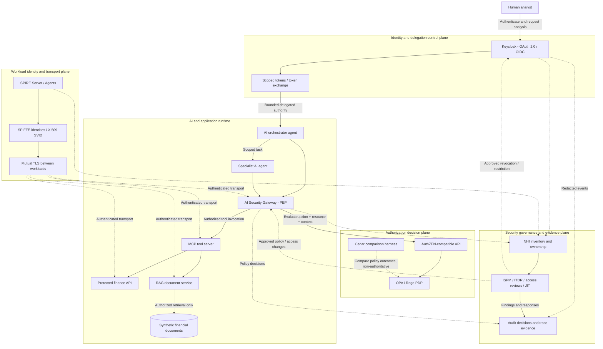
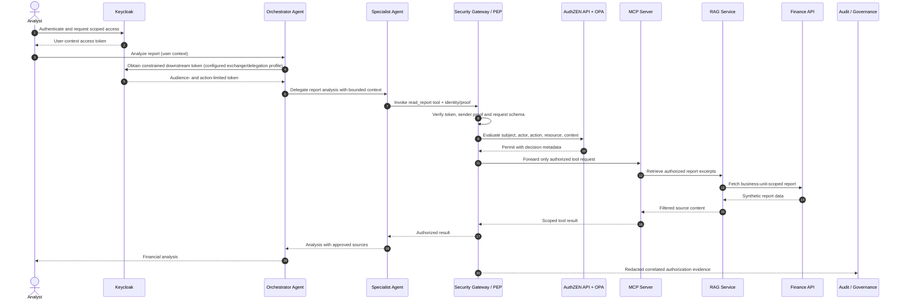
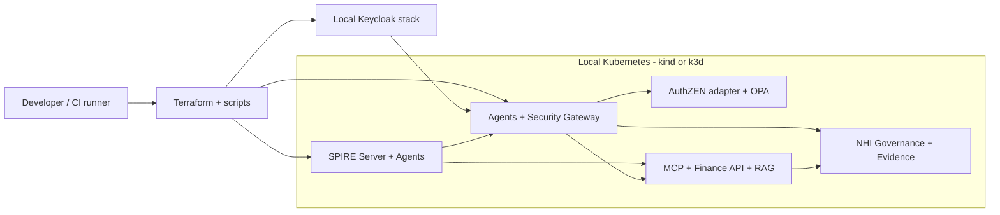

# Global Secure AI Operations - Repository Index

These four planned public repositories are independent reference-architecture projects designed to integrate into the Global Secure AI Operations environment.

| ID | GitHub repository name | Project title | Main focus |
|---|---|---|---|
| 01 | [advanced-oauth-delegation](https://github.com/kayky-matos/advanced-oauth-delegation) | Advanced OAuth, Delegation & Federated Identity | OAuth, OIDC, delegation, DPoP, mTLS, RAR |
| 02 | [cloud-native-workload-identity](https://github.com/kayky-matos/cloud-native-workload-identity) | Cloud-Native Workload Identity & Zero Trust | SPIFFE/SPIRE, Kubernetes, workload mTLS |
| 03 | [agentic-ai-security-gateway](https://github.com/kayky-matos/agentic-ai-security-gateway) | AI Agent Identity, MCP Security & Policy Authorization | MCP, AuthZEN, OPA, Cedar, RAG, agent policy |
| 04 | [nhi-governance-itdr](https://github.com/kayky-matos/nhi-governance-itdr) | Enterprise NHI Governance & Identity Threat Management | NHI inventory, IGA, ISPM, ITDR, JIT |

# Global Secure AI Operations

**Enterprise Agentic Identity & Zero Trust Security - Integrated Reference Architecture**

Global Secure AI Operations is a **fictional financial-services enterprise scenario** connecting four independently demonstrable security engineering projects into a single, end-to-end architecture for **human identities, AI agents, machine workloads, protected APIs, and non-human identity (NHI) governance**.

The design illustrates how an organization can allow an AI agent to analyze a synthetic financial report **without granting unrestricted access, confusing user and agent identities, or trusting tool calls solely because an LLM requested them**.

**Guiding principle:** authenticate every principal, carry the right delegation context, authorize every sensitive action against the intended resource, protect service-to-service transport, and preserve an auditable chain of decisions.

---

## 1. Architecture at a glance

| Dimension | Target approach |
|---|---|
| Human and OAuth identity | Keycloak, OAuth 2.0 / OpenID Connect, scoped tokens and token exchange |
| Delegated agent authority | Restricted audience, action, resource, actor/subject context, and token lifetime |
| Workload identity | SPIFFE/SPIRE, X.509-SVID, authenticated service-to-service mTLS |
| AI and tool security | Agent Security Gateway as policy enforcement point (PEP), MCP tool mediation |
| Authorization | AuthZEN-compatible evaluation API, OPA/Rego, optional Cedar comparison |
| Data and RAG access | Document-level authorization, business-unit boundaries, prompt-injection defenses |
| NHI security and governance | Discovery, ownership, IGA, ISPM, ITDR, JIT, review, remediation, audit |
| Platform | Local Kubernetes, Python APIs, Terraform/IaC, Docker, CI and repeatable security tests |
| Data | Synthetic fixtures only; no real financial or personal data |
| Cost model | Local/open-source-first; no mandatory paid cloud services |

### Integrated logical architecture



**Diagram interpretation:** dashed governance and workload-security connections represent architectural relationships, not automatically active integrations. A SPIFFE certificate alone does not enforce mTLS, and mTLS alone does not authorize a business operation. A resource server and gateway must independently enforce the intended policy.

---

## 2. Repository map

The reference architecture is divided into **four separate repositories**.

| # | Repository | Responsibility | Primary technologies |
|---|---|---|---|
| 01 | [`advanced-oauth-delegation`](https://github.com/kayky-matos/advanced-oauth-delegation) | Human/M2M OAuth identity, token exchange, constrained delegation, API token validation | Keycloak, OAuth, OIDC, JWT, DPoP, OAuth mTLS, Python |
| 02 | [`cloud-native-workload-identity`](https://github.com/kayky-matos/cloud-native-workload-identity) | Cryptographic workload identities, Kubernetes attestation, mTLS and federation experiments | SPIFFE, SPIRE, Kubernetes, X.509-SVID, Terraform |
| 03 | [`agentic-ai-security-gateway`](https://github.com/kayky-matos/agentic-ai-security-gateway) | Agent/tool authorization, MCP mediation, RAG access control and runtime intervention | MCP, FastAPI, AuthZEN, OPA/Rego, Cedar |
| 04 | [`nhi-governance-itdr`](https://github.com/kayky-matos/nhi-governance-itdr) | NHI discovery, ownership, least privilege reviews, threat detection and remediation | Python, IGA, ISPM, ITDR, JIT, audit APIs |

### Why four repositories?

- **Independent evidence:** each project has its own architecture, security tests, threat model, ADRs, deployment instructions and demo.
- **Explicit ownership:** identity issuance, workload identity, authorization enforcement, and security governance remain separate responsibilities.
- **Composable integration:** well-defined identity, decision and audit contracts allow projects to run alone or together.
- **Principal-level architecture:** architectural boundaries and security trade-offs can be reviewed without assuming a single monolithic codebase.

---

## 3. Enterprise scenario and security objectives

**Use case:** an authenticated analyst requests a financial report analysis. An orchestrator delegates a narrowly scoped task to a specialist agent. The specialist may retrieve only the authorized documents via a guarded MCP tool. The platform must prevent an attempt to export confidential information or modify report records.

### Security invariants

1. **No implicit trust:** a network location, AI model output, or recognized SPIFFE identity never grants authorization by itself.
2. **No confused deputy:** downstream actions remain bounded by the initiating user's grant and the permitted agent action; no tool may silently amplify privilege.
3. **No token substitution:** a protected API validates `iss`, `aud`, signature, time claims and any required sender constraint before processing a request.
4. **No bypass around the PEP:** privileged MCP calls, finance API actions and sensitive RAG retrieval are intercepted and authorized at a trusted enforcement boundary.
5. **No cross-business-unit leakage:** business-unit, resource classification and operation are evaluated before data retrieval and before model context assembly.
6. **Deny by default:** missing identity, invalid proof, absent policy, failed PDP or inconsistent delegation cause denial of sensitive actions.
7. **Separation of identities:** preserve distinctions among human subject, delegated actor/agent, OAuth client, and authenticated workload.
8. **Auditable lifecycle:** security events correlate access requests to identity, action, resource, policy decision and governance remediation without logging secrets.

### Trust boundaries

| Boundary | What crosses it | Required checks |
|---|---|---|
| Analyst → identity provider | User authentication and authorization request | Correct client, authentication, consent/policy, issuer |
| Identity provider → AI runtime | OAuth access/delegation token | JWT/JWKS or supported validation, scope, audience, delegation constraints |
| Agent → Security Gateway | Sensitive tool/API request | Token verification, trusted agent identity, normalized operation and arguments |
| Gateway → authorization service | Authorization decision request | Authenticated request, validated entity context, versioned policy, timeout behavior |
| Workload → workload | Network request | Verified peer SVID, trust bundle, identity allowlist, mTLS and application authorization |
| MCP/RAG → finance documents | Document retrieval | Tenant/business-unit, document-level rights, permitted purpose and action |
| Platform → governance plane | Identity and audit evidence | Provenance, deduplication, redaction, integrity, access controls |
| Governance → control planes | Revocation, policy update, JIT change | Explicit approval, narrow authority, idempotency, verification and rollback |

---

## 4. End-to-end authorized transaction



**Transport requirement:** the workload-to-workload calls above use **properly configured mTLS** backed by SPIFFE/SPIRE credentials in the integrated profile. Transport authentication and application authorization are separate, cumulative checks.

**Delegation caveat:** ordinary OAuth token exchange must not be presented as full actor-aware delegation unless the relevant identity provider profile actually preserves the necessary actor/subject semantics and the downstream resource enforces them. Experimental delegation support is isolated from the baseline implementation.

### Denied transaction: unauthorized export

```mermaid
sequenceDiagram
    autonumber
    participant Agent as Specialist Agent
    participant Gateway as Security Gateway / PEP
    participant PDP as AuthZEN API + OPA
    participant MCP as MCP Server
    participant Audit as Audit / ITDR

    Agent->>Gateway: export_report (read-only delegated context)
    Gateway->>Gateway: Verify token + requested action
    Gateway->>PDP: Evaluate export against resource and delegation
    PDP-->>Gateway: Deny (action exceeds delegated grant)
    Gateway-->>Agent: Forbidden; no downstream invocation
    Gateway-->>Audit: Decision, policy ID, correlation ID
    Note over Gateway,MCP: MCP tool is not invoked
```

The expected outcome is an **enforced denial**, not merely an LLM response saying that export is disallowed. The negative test must verify that the tool and underlying finance API received no unauthorized write/export call.

---

## 5. Security planes and component responsibilities

### 5.1 Identity and delegation

**Target controls:** OAuth Client Credentials for M2M workloads; OIDC sign-in for the analyst; resource-specific audiences and scopes; RFC 8693 token exchange; JWT/JWKS validation; DPoP (RFC 9449) and/or certificate-bound access tokens (RFC 8705); an isolated RFC 9396 RAR experiment; OAuth 2.0 Security Best Current Practice (RFC 9700).

**Non-negotiable design rule:** an authorization request is not proof that the requested permission was granted. APIs must enforce actual issued/granted rights and resource-level policy. Pin the Keycloak version and document any preview or extension behavior.

### 5.2 Workload identity and Zero Trust transport

**Target controls:** local Kubernetes cluster; SPIRE Server and Agents; workload attestation; SPIFFE IDs; short-lived X.509-SVIDs via Workload API; identity-bound mTLS; trust bundle renewal; optional local multi-trust-domain federation aligned with a **version-pinned WIMSE Internet-Draft**.

**Non-negotiable design rule:** authenticated workloads still require route/action-level authorization. Federation establishes a trust-validation relationship, **not blanket resource permission**.

### 5.3 Agent, MCP, RAG and policy authorization

**Target controls:** trusted gateway/PEP guarding privileged tool invocations; AuthZEN-compatible access evaluations backed by OPA/Rego; separately evaluated Cedar policy examples; MCP tool allowlisting and schema validation; cross-agent delegation checks; RAG document authorization; runtime deny/cancel actions; policy versioning.

**Non-negotiable design rule:** untrusted retrieved text and model-generated tool arguments are **data, not authority**. The PEP checks tool, action, resource and principal using trusted context. Cedar/Rego outcome differences must be surfaced, not silently assumed equivalent.

### 5.4 Governance, posture and response

**Target controls:** NHI discovery and normalization from Keycloak, SPIRE and agent services; owner mapping; entitlement inventory; orphan and excessive-privilege findings; access reviews; just-in-time privileges with TTL; identity-related detection rules; approved remediation with verification; audit evidence and posture metrics.

**Non-negotiable design rule:** discovery and detection are not equivalent to successful remediation. Revocation and JIT expiration must be tested against actual access decisions, and any simulated action must be labeled as simulated.

### 5.5 Cross-cutting engineering

Terraform-based local infrastructure provisioning, configuration-as-code, version-pinned containers and dependencies, Python test automation, SAST/dependency/IaC checks, ADRs, threat modeling, secure logging, CI/CD and clean environment teardown are required engineering practices across **all four** projects.

---

## 6. Integration contracts and source of truth

The integrated environment needs explicit contracts rather than shared assumptions:

| Contract | Producer → consumer | Required properties |
|---|---|---|
| OAuth authorization context | Keycloak → agent, gateway, finance API | Trusted issuer, intended audience, scopes/claims, token lifetime, proof binding where applicable |
| Delegation envelope | Orchestrator → specialist → gateway | Original subject, actor chain where supported, requested action, resource, expiry, stable request ID; no privilege amplification |
| Workload identity | SPIRE → workload → peer | SPIFFE ID, X.509-SVID, valid chain/bundle, peer identity verification and rotation |
| Access evaluation | Gateway → AuthZEN-facing PDP | Subject, resource, action, context, deterministic permit/deny, policy version and decision correlation |
| MCP invocation | Agent → gateway → MCP server | Tool allowlist, validated arguments, delegated authority, decision record; no public bypass |
| Document classification | Finance API/RAG → PEP/PDP | Resource ID, business unit, classification, owner and permitted operations from trusted metadata |
| Governance identity record | Identity adapters → inventory | Stable ID, source provenance, owner, environment, entitlements, lifecycle state, expiry and last-seen time |
| Security evidence | Control planes → audit/governance | Correlation ID, timestamp, identity references, resource/action, decision, rule/policy version, redacted reason |

**Authoritative ownership:** Keycloak owns OAuth issuance configuration; SPIRE owns SPIFFE issuance and trust material; the authorization service owns policy decisions; the gateway and resource servers own enforcement; governance owns identity inventory and documented review/remediation workflows. The governance inventory must not replace the source systems' own state.

### Example normalized access-evaluation context

This JSON illustrates an **internal normalized payload**, not a claim that it is an exact wire-format request for a particular AuthZEN specification revision.

```json
{
  "request_id": "req-demo-0042",
  "subject": { "id": "analyst-17", "business_unit": "retail" },
  "actor": { "id": "specialist-report-agent", "delegated_by": "orchestrator-agent" },
  "workload": { "spiffe_id": "spiffe://globalfin.local/ns/ai/sa/specialist" },
  "action": "reports:read",
  "resource": {
    "id": "report-2026-q3-retail",
    "business_unit": "retail",
    "classification": "confidential"
  },
  "context": {
    "environment": "lab",
    "delegation_expires_at": "2026-11-19T12:00:00Z"
  }
}
```

Implementations must map this normalized context to a **version-pinned AuthZEN request/response contract**, securely establish all identity claims and source resource metadata from trusted systems, and never accept user-supplied JSON as authoritative identity evidence.

---

## 7. Deployment and reproducibility

### Local target topology



**Deployment note:** the logical topology is illustrative. Actual Helm charts, namespaces, services, ports, secret stores and trust boundaries are defined by their owning repositories. The index must not imply that all workloads can be deployed with a single command before a tested integration orchestrator exists.

### Suggested integration repository layout

```text
global-secure-ai-operations/
├── README.md                         # This architecture overview
├── docs/
│   ├── architecture/
│   │   ├── trust-boundaries.md
│   │   ├── integration-contracts.md
│   │   └── deployment-topology.md
│   ├── adr/
│   │   └── README.md
│   ├── threat-model/
│   │   └── README.md
│   └── evidence/
│       └── README.md                 # Redacted, synthetic evidence only
├── integration/                       # Planned; add as integrations are implemented
│   ├── manifests/
│   ├── terraform/
│   ├── configs/
│   └── tests/
├── scripts/                           # Planned setup, demo and cleanup wrappers
├── .github/
│   └── workflows/                     # Planned Markdown and integration checks
└── LICENSE                            # Add an explicitly selected license
```

**Repository strategy:** the index repository should hold the shared architecture, integration contracts, deployment coordination and cross-repository acceptance evidence. Component source code and its unit/security tests should stay in the four specialized repositories; avoid copying them into this repository.

### Proposed integration lifecycle

1. Provision or start the local cluster and identity dependencies with pinned versions.
2. Deploy Project 01; verify authentication, M2M, token validation and constrained access.
3. Deploy Project 03; verify AuthZEN/OPA evaluation and MCP/RAG enforcement.
4. Deploy Project 02; verify SVID issuance, mTLS, trust rotation and application authorization.
5. Deploy Project 04; reconcile NHI sources, evaluate findings and verify JIT/remediation scenarios.
6. Run end-to-end positive and adversarial tests; capture **sanitized** logs and decision traces.
7. Tear down the environment and ensure no credentials or state containing secrets are committed.

These are **planned integration steps**, not already validated copy/paste commands.

---

## 8. Verification strategy and acceptance criteria

| Test ID | End-to-end scenario | Expected evidence |
|---|---|---|
| E2E-01 | Analyst accesses an authorized report through an agent and MCP | Successful scoped read, full correlated decision chain |
| E2E-02 | M2M client presents a valid token to intended API | Validated audience and expected resource-level access |
| E2E-03 | Token has wrong issuer/audience, bad signature or expired time | Request rejected before protected operation |
| E2E-04 | DPoP replay or sender/certificate binding mismatch | Invalid proof rejected; no downstream invocation |
| E2E-05 | Delegated agent requests write/export beyond its grant | Deny at PEP; no side effect in downstream tool/API |
| E2E-06 | Agent attempts to read another business unit's document | Deny before document reaches RAG/model context |
| E2E-07 | Unregistered or unauthorized workload accesses a service | Attestation/mTLS or resource-policy rejection, as appropriate |
| E2E-08 | SVID rotates, expires, or a peer uses an untrusted bundle | Renewal succeeds where valid; stale/untrusted identity fails |
| E2E-09 | Adversarial instructions appear inside retrieved content | Instructions cannot grant additional privileges or bypass tools |
| E2E-10 | AuthZEN/PDP returns error or times out | Sensitive tool action fails closed |
| E2E-11 | Orphaned or overprivileged NHI is discovered | Owner/risk finding with traceable source and review task |
| E2E-12 | JIT access expires or approved revocation is applied | Subsequent requests are denied; actual/simulated action clearly labeled |
| E2E-13 | End-to-end events reach governance evidence store | Timestamped trace with identities, action, resource, decision and policy version |
| E2E-14 | Full local environment is destroyed | No remaining managed lab infrastructure or exposed credentials |

### Evidence quality bar

For each relevant test, publish the **test name, configuration/version, input conditions, expected result, observed result, sanitized trace and reproducibility instructions**. A diagram or an isolated API response is not proof of a complete Zero Trust control. Never upload private keys, access tokens, raw credentials or sensitive data to GitHub or CI artifacts.

### Architectural decisions to document

| ADR | Decision area |
|---|---|
| ADR-001 | Four-repository split, integration ownership and change management |
| ADR-002 | Keycloak grant profiles and experimental actor-aware delegation boundaries |
| ADR-003 | Token lifetime, scopes, audiences, sender constraints and replay prevention |
| ADR-004 | SPIFFE trust domains, SVID rotation, workload registration and federation |
| ADR-005 | PEP placement, PDP outage behavior, AuthZEN version and policy versioning |
| ADR-006 | MCP authorization, RAG filtering and prompt-injection boundary |
| ADR-007 | NHI ownership, audit evidence retention, JIT and remediation approvals |
| ADR-008 | Local-only deployment, Terraform state and secret-handling limitations |

---

## 9. Threat model overview

**Assets:** user and agent credentials; workload identities and trust bundles; OAuth signing trust; delegated privileges; synthetic report documents; authorization policies; governance inventory and audit evidence.

**Representative attackers:** a malicious client, compromised AI agent/workload, untrusted retrieved document, unauthorized workload, misconfigured administrator, or adversary attempting credential replay or privilege escalation.

| Threat | Defensive design | Verification location |
|---|---|---|
| Stolen token / replay | Limited scope/lifetime, DPoP or OAuth mTLS where enabled, replay checks | 01 + integration |
| Confused deputy / token substitution | Subject/actor distinction, constrained exchange, audience and resource authorization | 01 + 03 |
| Unauthorized workload / spoofed identity | SPIRE attestation, peer SPIFFE verification, mTLS, application allowlists | 02 |
| Prompt injection / tool abuse | Trusted PEP, MCP argument validation, no authority from retrieved text | 03 |
| Cross-unit RAG exfiltration | Trusted document metadata, authorization before retrieval, scoped responses | 03 + integration |
| Policy outage / unexpected evaluation | Deny-by-default behavior and policy decision telemetry | 03 |
| Orphaned or overprivileged NHI | Discovery, owner assignment, risk classification, review and verified remediation | 04 |
| Forged/tampered audit evidence | Consistent correlation IDs, access control, sanitization and integrity verification | 04 + integration |

**Residual risk:** a local lab cannot prove production-grade security for hardware-rooted attestation, cloud IAM integration, high availability, key custody, full enterprise governance, regulatory compliance or operational response performance. Such claims require additional environments and evidence.

---

## 10. Milestones and delivery definition

| Phase | Deliverable | Exit condition |
|---|---|---|
| M1 - Identity foundation | Project 01 standalone lab | Valid/invalid token and delegated-access cases reproduced |
| M2 - Agent enforcement | Project 03 standalone gateway | MCP/RAG allow, deny, prompt-injection and fail-closed tests pass |
| M3 - Workload Zero Trust | Project 02 standalone lab | Identity issuance, mTLS and unauthorized peer tests pass |
| M4 - Governance | Project 04 standalone lab | NHI lifecycle, findings, review, JIT and remediation evidence exists |
| M5 - Integration | Shared contracts and integration automation | Cross-repository E2E-01 through E2E-14 have recorded outcomes |
| M6 - Architecture review | ADRs, threat model, controls, limitations and demo | Reproducible demonstration with documented residual risks |

### Status semantics

Use these labels consistently: **Planned** (design only), **In progress** (partial implementation), **Verified** (automated tests plus evidence), or **Experimental** (preview or draft-based interoperability). Do not use badges implying build success or security certification without verified results.

---

## 11. Source material and specifications

The integration architecture is informed by the four Global project specifications and by the following technical standards and projects. **Implementation conformance depends on the versions and test evidence in each repository.**

- [OAuth 2.0 Token Exchange - RFC 8693](https://www.rfc-editor.org/rfc/rfc8693)
- [OAuth 2.0 Rich Authorization Requests - RFC 9396](https://www.rfc-editor.org/rfc/rfc9396)
- [OAuth 2.0 Security Best Current Practice - RFC 9700](https://www.rfc-editor.org/rfc/rfc9700)
- [OAuth 2.0 Demonstrating Proof of Possession (DPoP) - RFC 9449](https://www.rfc-editor.org/rfc/rfc9449)
- [OAuth 2.0 Mutual-TLS Client Authentication and Certificate-Bound Access Tokens - RFC 8705](https://www.rfc-editor.org/rfc/rfc8705)
- [OpenID AuthZEN](https://openid.net/wg/authzen/)
- [Keycloak documentation](https://www.keycloak.org/documentation)
- [SPIFFE documentation](https://spiffe.io/docs/latest/)
- [SPIRE documentation](https://spiffe.io/docs/latest/spire-about/)
- [Open Policy Agent](https://www.openpolicyagent.org/docs)
- [Cedar policy language](https://www.cedarpolicy.com/)
- [Model Context Protocol](https://modelcontextprotocol.io/)
- [IETF WIMSE working group](https://datatracker.ietf.org/wg/wimse/about/)

---

## 12. Portfolio scope, non-goals and documentation policy

This is a **reference architecture and educational security engineering portfolio**, not a live banking platform. It deliberately uses synthetic data and favors locally reproducible components. It does not claim certification, regulatory approval, production reliability, comprehensive multicloud integration or support for every preview/draft feature.

**Portfolio outcome:** four independently reviewable engineering repositories plus one architecture index showing how identity, delegation, workload trust, agent authorization and NHI governance compose into a defensible Enterprise AI Zero Trust operating model.
